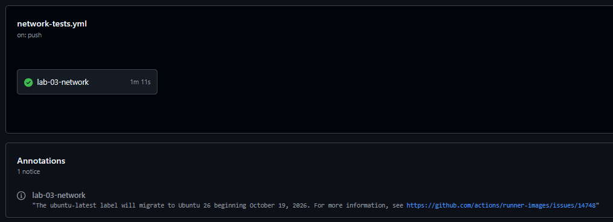

# Lab 05: Network Tests in CI

## Overview

| | |
|---|---|
| **Goal** | Test the Lab 03 network with pytest, then have GitHub Actions build the whole network from the repository and run those tests on every push and pull request |
| **Runs on** | pytest on my computer, and GitHub Actions (Ubuntu, Containerlab 0.81.1, FRRouting 10.7.1) |
| **Cost** | Free. GitHub Actions is free for public repositories |
| **Time** | About three hours |

This lab brings the series together. The [Lab 03](../lab-03-bgp) network is the system under test, the [Lab 04](../lab-04-python-automation) functions do the checking, and GitHub Actions does what my [FastAPI Asset Register](https://github.com/iM-MQ/fastapi-asset-register) pipeline does for an application: on every push, it builds the network from scratch on a clean machine, tests it, and passes or fails the build.



The first CI run found a problem my own computer never could: every router's saved configuration contained a line that came from my machine, not from my configuration ([Issue 1](#1-the-drift-tests-failed-on-github-but-passed-on-my-computer)).

---

## How it works

```
 git push ──► GitHub Actions: "Network tests" (a fresh Ubuntu machine)
               ├── install Python, pytest and Containerlab 0.81.1
               ├── build the Lab 03 network from the repository
               ├── wait for OSPF and BGP to converge
               ├── run 14 pytest checks ──► pass or fail the build
               ├── if anything failed: run collect.py to show every router's state
               └── always: destroy the network
```

### The 14 tests

| Test | What it checks |
|---|---|
| Inventory | Containerlab built exactly r1, r2, r3 and r4 |
| OSPF neighbours, ×4 | Every router has OSPF neighbours, and all are `Full` |
| BGP sessions, ×2 | r2 and r3 each have one session, `Established` |
| Company A's policy | r2 receives 2 routes from Company B |
| Company B's filter | r3 receives only 1 route, and r4 has Company A's LAN but not `1.1.1.1/32` |
| End to end | pc1 can ping pc2 |
| No drift, ×4 | Every running configuration matches the repository |

### Waiting for convergence

In Lab 03, BGP came up empty for about 40 seconds while OSPF settled. Tests run in that window would fail for no real reason, which makes them **flaky**. So a set-up step (a pytest **fixture**, shared by every test) waits until routes have crossed BGP and reached the far side of both companies, for up to 3 minutes:

```python
def converged(routers):
    """True once routes have crossed BGP and been redistributed into both companies' OSPF."""
    return has_route(routers["r1"], "192.168.4.0/24") and has_route(routers["r4"], "192.168.1.0/24")


@pytest.fixture(scope="session")
def routers():
    """The lab's routers, once the network has had time to converge."""
    found = load_routers(DEFAULT_TOPOLOGY)
    deadline = time.monotonic() + CONVERGENCE_TIMEOUT
    while time.monotonic() < deadline and not converged(found):
        time.sleep(5)
    # If it never converged, carry on so the tests report exactly what is wrong
    return found
```

If the network never converges, the tests still run, so the failures say exactly what is wrong.

### Reusing Lab 04

`conftest.py`, which pytest reads first, adds the Lab 04 folder to Python's search path, so the tests import `collect.py` and `backup.py` rather than copying them:

```python
# Reuse the Lab 04 functions instead of copying them
sys.path.insert(0, str(Path(__file__).resolve().parent.parent / "lab-04-python-automation"))
```

A fix in Lab 04 is a fix in Lab 05 too, which mattered in [Issue 1](#1-the-drift-tests-failed-on-github-but-passed-on-my-computer).

---

## The files

| File | Purpose |
|---|---|
| [`test_network.py`](test_network.py) | The 14 tests and the convergence fixture |
| [`conftest.py`](conftest.py) | Makes the Lab 04 functions importable |
| [`requirements.txt`](requirements.txt) | `pytest==9.1.1`, the version GitHub Actions installs |
| [`.github/workflows/network-tests.yml`](../.github/workflows/network-tests.yml) | The workflow, at the root of the repository, where GitHub looks for it |

### The workflow

```yaml
# Builds the Lab 03 network from the repository and tests it, on every push and pull request
name: Network tests

on:
  push:
    branches: [main]
  pull_request:
  workflow_dispatch:

# The workflow only needs to read the code
permissions:
  contents: read

jobs:
  lab-03-network:
    runs-on: ubuntu-latest
    timeout-minutes: 20

    steps:
      - name: Check out the code
        uses: actions/checkout@v5

      - name: Set up Python
        uses: actions/setup-python@v6
        with:
          python-version: "3.13"

      - name: Install pytest
        run: python -m pip install -r lab-05-ci/requirements.txt

      # The same Containerlab version as on my computer
      - name: Install Containerlab
        run: bash -c "$(curl -sL https://get.containerlab.dev)" -- -v 0.81.1

      - name: Build the Lab 03 network
        run: sudo containerlab deploy -t lab-03-bgp/lab03.clab.yml

      - name: Run the network tests
        run: python -m pytest -v lab-05-ci

      - name: Show every router's state if a test failed
        if: failure()
        run: python lab-04-python-automation/collect.py

      - name: Destroy the network
        if: always()
        run: sudo containerlab destroy -t lab-03-bgp/lab03.clab.yml --cleanup
```

| Part | Why |
|---|---|
| `permissions: contents: read` | Least privilege: the workflow can only read the code |
| `-v 0.81.1` | Pins Containerlab to the version I use locally, so CI tests what I tested |
| `sudo containerlab deploy` | Building a network needs root. On my computer, Containerlab's setup gave my user that right instead |
| `if: failure()` | Runs the Lab 04 health report only when a test fails, so the log shows every router's state |
| `if: always()` | Destroys the network whether the tests passed or not |
| `timeout-minutes: 20` | Stops a stuck run rather than letting it use up Actions minutes |

---

## Following along?

- I ran every local command in a **Debian** terminal on WSL2, inside `~/network-automation-labs`, unless a step says otherwise.
- Each command is in its own box. Run **one line at a time**.
- Boxes marked **What I saw** show my output. They are not commands to run.

---

## How I built it

### Step 1: Installed pytest locally

```bash
sudo apt -y install python3-pytest
```

Debian packages pytest 8.3.5, and the workflow installs 9.1.1. These tests use only basic pytest features, and they passed on both.

### Step 2: Created the tests and excluded pytest's cache

I created the three files in this folder, and added `.pytest_cache/` to the repository's `.gitignore`.

### Step 3: Started the Lab 03 network

```bash
cd ~/network-automation-labs/lab-03-bgp
```

```bash
clab deploy -t lab03.clab.yml
```

No waiting needed: the fixture waits for convergence.

---

## Tests I carried out

### Test 1: The faults the tests catch

I shut down the link between the two companies, then ran the tests:

```bash
docker exec clab-lab03-r2 vtysh -c "configure terminal" -c "interface eth2" -c "shutdown"
```

```bash
cd ~/network-automation-labs
```

```bash
python3 -m pytest -v lab-05-ci
```

**What I saw** (shortened):

```
lab-05-ci/test_network.py::test_inventory_lists_all_four_routers PASSED
lab-05-ci/test_network.py::test_ospf_neighbours_are_full[r1] PASSED
...
lab-05-ci/test_network.py::test_bgp_session_is_established[r2] FAILED
lab-05-ci/test_network.py::test_bgp_session_is_established[r3] FAILED
lab-05-ci/test_network.py::test_company_a_accepts_both_company_b_routes FAILED
lab-05-ci/test_network.py::test_company_b_filter_drops_company_a_loopback FAILED
lab-05-ci/test_network.py::test_pc1_can_reach_pc2 FAILED
lab-05-ci/test_network.py::test_running_config_matches_repository[r1] PASSED
lab-05-ci/test_network.py::test_running_config_matches_repository[r2] FAILED
...
E       AssertionError: [('10.0.23.2', 65002, 'Active', 0, 0)]
...
E         At index 23 diff: ' shutdown' != 'exit'
...
6 failed, 8 passed in 188.58s (0:03:08)
```

- The fixture waited the full 3 minutes, because the network never converged.
- **OSPF passed everywhere**: each company's own network was healthy.
- **Everything that depends on the link failed**: both BGP sessions were `Active`, no routes crossed, and pc1 could not reach pc2.
- **The drift test found the cause**, a `shutdown` line in r2's running configuration that is not in the repository.

### Test 2: A healthy network passes

After `no shutdown`:

```bash
python3 -m pytest -v lab-05-ci
```

**What I saw:**

```
14 passed in 4.48s
```

The network was already converged, so the fixture returned at once.

### Test 3: GitHub Actions builds and tests the network

After I fixed the two issues below, the third run on GitHub passed in 1 minute 11 seconds.

**What I saw** in **Run the network tests**:

```
platform linux -- Python 3.13.17, pytest-9.1.1, pluggy-1.7.0
collecting ... collected 14 items

lab-05-ci/test_network.py::test_inventory_lists_all_four_routers PASSED  [  7%]
lab-05-ci/test_network.py::test_ospf_neighbours_are_full[r1] PASSED      [ 14%]
lab-05-ci/test_network.py::test_ospf_neighbours_are_full[r2] PASSED      [ 21%]
lab-05-ci/test_network.py::test_ospf_neighbours_are_full[r3] PASSED      [ 28%]
lab-05-ci/test_network.py::test_ospf_neighbours_are_full[r4] PASSED      [ 35%]
lab-05-ci/test_network.py::test_bgp_session_is_established[r2] PASSED    [ 42%]
lab-05-ci/test_network.py::test_bgp_session_is_established[r3] PASSED    [ 50%]
lab-05-ci/test_network.py::test_company_a_accepts_both_company_b_routes PASSED [ 57%]
lab-05-ci/test_network.py::test_company_b_filter_drops_company_a_loopback PASSED [ 64%]
lab-05-ci/test_network.py::test_pc1_can_reach_pc2 PASSED                 [ 71%]
lab-05-ci/test_network.py::test_running_config_matches_repository[r1] PASSED [ 78%]
lab-05-ci/test_network.py::test_running_config_matches_repository[r2] PASSED [ 85%]
lab-05-ci/test_network.py::test_running_config_matches_repository[r3] PASSED [ 92%]
lab-05-ci/test_network.py::test_running_config_matches_repository[r4] PASSED [100%]

============================== 14 passed in 53.13s ==============================
```

Most of the 53 seconds was the fixture waiting for OSPF and BGP to converge on the fresh network. **Show every router's state if a test failed** was skipped, because nothing failed.

| Test | Expected | Result |
|---|---|---|
| 1. Link down, locally | BGP, policy, reachability and r2's drift test fail. OSPF passes | ✅ |
| 2. Healthy network, locally | 14 passed | ✅ |
| 3. GitHub Actions | Network built from the repository, 14 passed | ✅ |

---

## Issues I hit and how I fixed them

### 1. The drift tests failed on GitHub but passed on my computer

**Symptom.** The first CI run: 10 tests passed, but all four drift tests failed with the same difference:

```
E         At index 3 diff: 'no ipv6 forwarding' != 'domainname localdomain'
...
E         -     'domainname localdomain',
```

**Investigation.** The `-` meant the line was in the repository copy but not in the router running on GitHub. Every other line matched.

**Root cause.** I never configured `domainname`. FRR picks it up from the machine it runs on, as it does the hostname. On my computer the containers get `localdomain`, so FRR wrote that line into the configurations I saved in Lab 03. GitHub's machines give the containers no domain name. The repository's "golden" configurations contained something that belonged to my environment, not to my design.

**Fix.** The drift check now ignores `domainname`, the same way it ignores the header lines of `show running-config`. Because Lab 05 imports Lab 04's `normalise` function, one fix covered both:

```python
        # FRR picks up the domain name from the machine it runs on, so it is not configuration
        if line.startswith("domainname "):
            continue
```

**Lesson.** A test that only ever runs on one machine cannot find dependencies on that machine. Running the same tests in a clean environment is what exposed this.

### 2. A pasted edit broke `backup.py`

**Symptom.** The second CI run stopped after 0.17 seconds with `collected 0 items / 1 error`:

```
E     File ".../lab-04-python-automation/backup.py", line 44
E       continue        lines.append(line)
E   SyntaxError: invalid syntax
```

The health report that ran afterwards showed neighbours in `Init` and sessions `Idle`, but only because the tests had stopped before the network had time to converge.

**Root cause.** The block I pasted for Issue 1 did not end with a line break, so its last line joined the next line of the file.

**Fix.** I split the line, then checked the file before pushing:

```bash
python3 -m py_compile lab-04-python-automation/backup.py
```

It printed nothing, meaning the file was valid, and the third run passed.

**Lesson.** `py_compile` takes a second and catches this before it reaches CI. I now run it after every edit to a Python file.

---

## Clean-up

The workflow destroys its own network. Locally:

```bash
cd ~/network-automation-labs/lab-03-bgp
```

```bash
clab destroy -t lab03.clab.yml --cleanup
```

---

## Command reference

| Command | What it does |
|---|---|
| `python3 -m pytest -v lab-05-ci` | Runs the network tests, listing each one |
| `python3 -m py_compile <file>` | Checks a Python file is valid without running it |
| `bash -c "$(curl -sL https://get.containerlab.dev)" -- -v <version>` | Installs a specific Containerlab version |
| `sudo containerlab deploy -t <file>` | Builds a network (as root, as in CI) |
| `sudo containerlab destroy -t <file> --cleanup` | Removes it |

## What I learned

- Network behaviour can be tested like application code: each test states one fact the network must meet.
- Tests on a network must wait for convergence, or they fail for reasons that have nothing to do with the design.
- Good tests fail precisely. With the link down, OSPF passed and everything depending on the link failed, and the drift test named the cause.
- CI on a clean machine found a dependency on my own computer that local testing never could.
- Reusing the Lab 04 functions meant one fix covered both labs.
- Checking a file before pushing is quicker than waiting for CI to find a typing mistake.

---

## References

Official documentation I used while building and testing this lab.

| What I did | Documentation |
|---|---|
| Wrote the tests and the fixture | [pytest: How to use fixtures](https://docs.pytest.org/en/stable/how-to/fixtures.html) |
| Ran one test per router | [pytest: How to parametrize fixtures and test functions](https://docs.pytest.org/en/stable/how-to/parametrize.html) |
| Shared set-up across tests | [pytest: conftest.py, local per-directory plugins](https://docs.pytest.org/en/stable/how-to/writing_plugins.html#conftest-py-local-per-directory-plugins) |
| Installed Containerlab at a pinned version | [Containerlab: Installation](https://containerlab.dev/install/) |
| Wrote the workflow | [GitHub Actions: Workflow syntax](https://docs.github.com/en/actions/using-workflows/workflow-syntax-for-github-actions) |
| Ran steps only on failure, or always | [GitHub Actions: Expressions, status check functions](https://docs.github.com/en/actions/reference/workflows-and-actions/expressions#status-check-functions) |
| Limited the workflow's permissions | [GitHub Actions: Assigning permissions to jobs](https://docs.github.com/en/actions/using-jobs/assigning-permissions-to-jobs) |
| Added the status badge | [GitHub Actions: Adding a workflow status badge](https://docs.github.com/en/actions/monitoring-and-troubleshooting-workflows/adding-a-workflow-status-badge) |